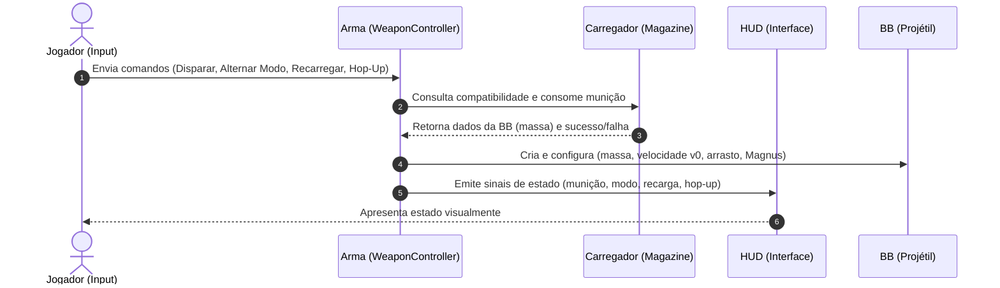

# Documento de Requisitos de Software (SRS) - Airsoft Simulator

Este documento estabelece a especificação de requisitos e a arquitetura técnica para o simulador de Airsoft desenvolvido em **Godot Engine 4 (GDScript)**.

---

## 1. Visão Geral do Sistema

O objetivo do projeto é simular com precisão a operação de réplicas de Airsoft e a física de projéteis esféricos de 6mm (BBs). 

O sistema separa estritamente o fluxo de entrada do **Jogador**, o controle da **Arma**, a gestão do **Carregador (Magazine)**, o cálculo físico da **BB (Projétil)** e a exibição de dados no **HUD**.

---

## 2. Arquitetura e Fluxo de Comunicação

A arquitetura adota orientação a eventos (`Signals`), inversão de dependência e dados desacoplados (`Custom Resources`).



### 2.1 Diagrama de Entidades e Responsabilidades

```
┌────────────────────────────────────────────────────────┐
│                   Jogador (Player)                     │
│  - Captura inputs (Gatilho, Seletor, Recarga, Hop-Up)  │
│  - Direciona comandos para a Arma ativa                │
└───────────────────────────┬────────────────────────────┘
                            │ Envia comandos
                            ▼
┌────────────────────────────────────────────────────────┐
│                     Arma (Weapon)                      │
│  - Compatibilidade com tipo de carregador              │
│  - Parâmetros: Energia (Joules), Cadência (RPM)        │
│  - Modos de disparo: SEMI e AUTO                       │
│  - Cooldown de cadência e controle de recarga          │
│  - Regulagem de Hop-Up                                 │
└───────┬───────────────────┬────────────────────┬───────┘
        │ Consulta e        │ Emite eventos      │ Cria e
        │ consome           │ de estado          │ configura
        ▼                   ▼                    ▼
┌─────────────────┐ ┌───────────────┐ ┌──────────────────┐
│   Carregador    │ │   HUD / UI    │ │   BB Projétil    │
│   (Magazine)    │ │               │ │                  │
│ - Tipo          │ │ - Apresenta   │ │ - Massa (kg)     │
│ - Capacidade    │ │   munição     │ │ - Velocidade (v0)│
│ - Qtd. atual    │ │ - Modo atual  │ │ - Arrasto (Drag) │
│ - Massa da BB   │ │ - Status hop  │ │ - Efeito Magnus  │
└─────────────────┘ └───────────────┘ └──────────────────┘
```

---

## 3. Especificação dos Módulos

### 3.1 Jogador (Player / Input)
- **Responsabilidade**: Capturar comandos de entrada do usuário e delegá-los à arma atualmente equipada.
- **Comandos emitidos para a Arma**:
  - `atirar(pressionado: bool)`: comando de gatilho.
  - `alternar_modo_tiro()`: comando para ciclar entre `SEMI` e `AUTO`.
  - `recarregar()`: comando de inserção/troca de carregador.
  - `ajustar_hop_up(delta: float)`: comando para aumentar ou diminuir a pressão do bucking.

---

### 3.2 Arma (Configurações e Subsistemas)

Cada arma armazena ou recebe a seguinte tabela de configurações normativas:

| Propriedade | Responsabilidade |
| :--- | :--- |
| **Tipo de carregador** | Define quais carregadores podem ser equipados (`compatible_magazine_type`). |
| **Modelo** | Identifica o modelo específico da arma (ex: `Shotgun`, `Rifle`, `Pistol1911`, `PistolGlock`). |
| **Ajuste da mola** | Modifica a energia $E$ e, consequentemente, a velocidade de saída do disparo. |
| **Rotação do motor** | Valor em RPM do motor elétrico/mecanismo usado no cálculo da cadência. |
| **Carregador equipado** | Referência ao carregador conectado; fornece quantidade e massa das BBs disponíveis. |
| **Modo de tiro** | Alterna entre semiautomático (`SEMI`) e automático (`AUTO`). |
| **Hop-up** | Controla o valor enviado a `BackspinDrag` (sustentação e rotação na BB). |

---

#### 3.2.1 Ajuste da Mola (Modelagem de Energia e Velocidade)

O ajuste da mola produz alteração mensurável na energia do disparo. O sistema suporta e documenta os seguintes modelos de cálculo:

1. **Modelo Físico (Padrão Implementado)**:
   - Utiliza a constante elástica $k$ ($\text{N/m}$) e a compressão linear $x$ ($\text{m}$), calculando a energia potencial elástica transferida:
     $$E = \frac{1}{2} k x^2$$
2. **Modelo Simplificado**:
   - O ajuste define diretamente o valor de energia nominal da boca em Joules ($E$).

* **Cálculo da Velocidade de Saída**:
  Em ambos os modelos, a velocidade $v$ da BB é calculada dinamicamente com base na massa $m$ obtida do carregador equipado:
  $$v = \sqrt{\frac{2E}{m}}$$
  > [!IMPORTANT]
  > É estritamente proibido o uso de velocidade fixa para todas as massas. BBs mais leves (ex: 0.20g) atingem velocidades maiores, enquanto BBs mais pesadas (ex: 0.30g) saem com menor velocidade para uma mesma energia $E$.

---

#### 3.2.2 Motor e Cadência (ROF e Intervalo entre Disparos)

A rotação do motor determina o intervalo mínimo entre disparos através da relação com o número $N$ de rotações necessárias pelo conjunto de engrenagens (*gearbox*) para completar um ciclo de disparo:

$$\text{ROF} = \frac{\text{RPM}}{60 \cdot N} \quad (\text{BBs por segundo})$$

$$\text{intervalo} = \frac{1}{\text{ROF}} \quad (\text{segundos})$$

* **Exemplo de Calibração**:
  - Rotação do motor = $8.100\text{ RPM}$
  - Rotações por disparo ($N$) = $30$
  - $\text{ROF} = \frac{8100}{60 \cdot 30} = 4.5\text{ BB/s}$
  - $\text{intervalo} = \frac{1}{4.5} \approx 0.222\text{ s}$

* **Regras Mandatórias de Cadência**:
  1. **Sensibilidade**: Aumentar a rotação do motor deve obrigatoriamente aumentar a cadência ($\text{ROF}$).
  2. **Bloqueio de Intervalo**: Nenhum modo de tiro (`SEMI` ou `AUTO`) pode ignorar o intervalo calculado. No modo `SEMI`, acionamentos mais rápidos do que `intervalo` são descartados (respeitando o ciclo mecânico).
  3. **Verificabilidade e Depuração**: O valor atual de `ROF` (e `intervalo`) deve poder ser verificado no editor (via `@export`), console/log (`print`) ou ferramenta de depuração/HUD.

---

### 3.7 Hop-up Ajustável

O sistema de Hop-up permite regulagem contínua pelo jogador para calibrar a sustentação balística através da rotação retrógrada (*backspin*):

- **Controle de Entrada**: Utiliza a **roda do mouse** (*Mouse Wheel Up / Down*) para aumentar ou reduzir manualmente o valor de Hop-up.
- **Valores Mínimo e Máximo**:
  - Devem ser definidos limites explícitos no script/recurso da arma (exemplo: `min_hop_up = 0.0` e `max_hop_up = 2500.0` rad/s ou escala de $0\%$ a $100\%$).
- **Limitação de Faixa (*Clamping*)**:
  - O valor de ajuste deve ser obrigatoriamente restringido ao intervalo permitido usando `clamp(novo_valor, min_hop_up, max_hop_up)`.
- **Exibição no HUD**:
  - O valor atual calibrado deve ser emitido via sinal e exibido permanentemente no HUD.
- **Aplicação Balística via `BackspinDrag`**:
  - O valor regulado é aplicado imediatamente aos **próximos projéteis** disparados por meio do parâmetro/componente `BackspinDrag` da BB.
- **Prevenção de Conflito de Interface**:
  - O sistema deve garantir que o scroll do mouse **não altere o Hop-up** caso o jogador esteja interagindo com outra interface/menu que utilize o mesmo comando (ex: menus roláveis, inventário ou popups). Essa validação deve ocorrer capturando eventos prioritários de UI (`_gui_input` / foco de controles) ou restringindo o ajuste ao método `_unhandled_input()`.

---

### 3.3 Carregador (Magazine)

Cada carregador deve ser um objeto independente (`Resource` ou `Node`) e possuir:

| Propriedade | Regra |
| :--- | :--- |
| **Tipo** | Uma das quatro opções de compatibilidade (`MAG_SHOTGUN_SHELL`, `MAG_RIFLE_STANAG`, `MAG_PISTOL_1911`, `MAG_PISTOL_GLOCK`). |
| **Capacidade** | Quantidade máxima de BBs; deve ser maior que zero ($C > 0$). |
| **Quantidade atual** | Deve permanecer obrigatoriamente entre zero e a capacidade ($0 \le Q \le C$). |
| **Massa das BBs** | Exemplos: $0,20\text{ g}$, $0,25\text{ g}$ ou $0,32\text{ g}$. |

> [!IMPORTANT]
> **Unidades de Medida**: Armazene a massa sempre em **quilogramas** ($kg$) nos cálculos físicos (ex: $0,20\text{ g} = 0,00020\text{ kg}$). Converta para gramas ($g$) exclusivamente para exibição na interface/HUD.

#### 3.3.1 Regras de Operação no Momento do Disparo
Ao disparar:
1. **Verificação de Carregador**: Verifique se existe um carregador equipado na arma.
2. **Verificação de Munição**: Verifique se ainda há munição disponível no carregador (`quantidade_atual > 0`).
3. **Obtenção de Massa**: Obtenha do carregador equipado a massa da BB ($m$ em $kg$).
4. **Cálculo da Velocidade**: Calcule a velocidade de saída correspondente à energia atual da arma ($v = \sqrt{2E/m}$).
5. **Consumo de Munição**: Desconte exatamente **uma unidade de munição** somente se o disparo efetivamente ocorrer.

> [!WARNING]
> **Carregador Vazio**: Quando o carregador estiver vazio (ou ausente), a arma **não deve instanciar uma BB**. Forneça retorno sonoro (clique de percussor / *dry-fire*), visual ou uma mensagem temporária para indicar a tentativa sem munição.

#### 3.3.2 Coleta e Troca de Carregador (Itens Coletáveis no Cenário)

Carregadores coletáveis devem ser espalhados pelo cenário como objetos interativos (ex: `Area3D` com colisão e mesh). Ao interagir com um deles (ou coletá-lo):

1. **Validação de Compatibilidade**: Verifique se o tipo do carregador coletado é compatível com a arma equipada.
2. **Substituição de Carregador**: Se for compatível, substitua o carregador equipado pelo novo carregador.
3. **Atualização da Interface**: Atualize imediatamente a massa das BBs e a contagem de munição exibidas na interface (HUD).
4. **Aplicação nos Disparos Seguintes**: Use a massa da BB do novo carregador em todos os disparos subsequentes para cálculo de velocidade e balística.
5. **Tratamento de Incompatibilidade**: Se for incompatível, mantenha o carregador atual intacto e informe o motivo ao jogador (mensagem na UI ou feedback sonoro de recusa).

> [!TIP]
> **Requisito Mínimo vs Melhoria**:
> - *Requisito mínimo*: O carregador anterior é apenas substituído/descartado.
> - *Melhoria implementada*: O carregador anterior é instanciado no cenário exatamente no local da troca, preservando sua quantidade de munição restante para que possa ser recuperado posteriormente.

---

### 3.4 Modos de Tiro

O sistema implementa dois modos operacionais:

- **Semiautomático (`SEMI`)**: Exatamente um disparo para cada acionamento do comando de tiro (requer soltar e pressionar novamente o gatilho).
- **Automático (`AUTO`)**: Disparos contínuos enquanto o comando de tiro estiver pressionado, sempre respeitando a cadência ($\text{ROF}$ e intervalo) da arma.

#### 3.4.1 Controles e Regras de Alternância
- **Tecla de Alternância**: A tecla **`F`** deve alternar entre os modos semiautomático e automático.
- **Feedback na Interface**: A interface/HUD deve informar claramente qual modo está ativo no momento.
- **Invariância de Ciclo**: Alternar o modo **não** recarrega a arma, **não** reinicia o carregador e **não** permite antecipar o próximo disparo (o timer de cooldown do intervalo entre tiros permanece inalterado).

---

### 3.5 HUD (Interface do Usuário)

O HUD deve apresentar elementos visuais de monitoramento contínuo com arquitetura puramente **reativa e orientada a eventos**.

#### 3.5.1 Elementos de Exibição Permanente
O HUD deve exibir permanentemente:
1. **Munição atual e capacidade**: Formato `Atual / Capacidade` (exemplo: `18 / 30`).
2. **Massa das BBs em gramas**: Exibição da gramatura convertida (exemplo: `0,25 g`).
3. **Modo de tiro atual**: `SEMI` ou `AUTO`.
4. **Ajuste atual do Hop-up**: Indicador numérico ou percentual da regulagem ativa enviada ao `BackspinDrag`.

#### 3.5.2 Regras de Atualização do HUD (Desempenho e Reatividade)
- **Gatilhos de Atualização**: O HUD deve ser atualizado exclusivamente quando ocorrer:
  1. Um **disparo** realizado (decremento de munição);
  2. Uma **troca de carregador** (nova contagem, capacidade e massa da BB);
  3. Uma **mudança de modo de tiro** (alternância via tecla `F`);
  4. Um **ajuste de Hop-up** (modificação da rotação angular).
- **Notificações Temporárias**: Exibir mensagens transitórias ao jogador em eventos de *disparo seco* (sem munição) ou *carregador incompatível*.

> [!CAUTION]
> **Otimização de Processamento**: É terminantemente proibido procurar objetos da cena a cada frame (`_process` / `_physics_process`) apenas para atualizar textos do HUD. A sincronização deve ocorrer via conexão de sinais (`Signals`).

---

### 3.6 BB (Projétil / Simulação Balística)
- **Responsabilidade**: Comportamento dinâmico em voo após o disparo via física de corpos rígidos (`RigidBody3D`).
- **Parâmetros configurados pela Arma**:
  - `mass` ($m$): Massa individual da esfera obtida do carregador.
  - `linear_velocity` ($\vec{v}_0$): Vetor de velocidade inicial.
  - `angular_velocity` ($\vec{\omega}$): Rotação inicial em torno do eixo horizontal lateral (Backspin).
- **Forças aplicadas a cada ciclo de física (`_physics_process`)**:
  1. **Arrasto Aerodinâmico ($\vec{F}_{\text{arrasto}}$)**:
     $$\vec{F}_{\text{drag}} = -\frac{1}{2} \cdot \rho \cdot C_d \cdot A \cdot |\vec{v}|^2 \cdot \hat{v}$$
     - $\rho = 1.225\text{ kg/m}^3$ (densidade do ar)
     - $C_d = 0.47$ (coeficiente de arrasto esférico)
     - $A = \pi \cdot r^2$ ($r = 0.003\text{ m}$)
  2. **Efeito Magnus / Hop-Up ($\vec{F}_{\text{magnus}}$)**:
     $$\vec{F}_{\text{magnus}} = C_m \cdot \rho \cdot A \cdot r \cdot (\vec{\omega} \times \vec{v})$$
     - Gera sustentação vertical quando $\vec{\omega}$ é perpendicular à velocidade $\vec{v}$.
  3. **Gravidade ($\vec{F}_g$)**:
     $$\vec{F}_g = m \cdot \vec{g}$$
     - Integrada diretamente pela simulação física do Godot Engine.
- **Rastro e Colisão**:
  - Renderização de rastro contínuo (`ImmediateMesh`).
  - Desativação do rastro e remoção/pool de instâncias após colisão ou tempo limite de voo.

---

## 4. Tipos de Armas e Especificações Técnicas

O simulador suporta quatro classes/modelos principais de armas, cada uma com sua compatibilidade de carregador, perfil de energia e cadência:

| Arma | Tipo de Carregador Compatível | Modos de Tiro | Cadência (RPM) | Energia Típica | Comportamento de Instanciação do Projétil |
| :--- | :--- | :--- | :--- | :--- | :--- |
| **Shotgun** | `MAG_SHOTGUN_SHELL` | `SEMI` / `PUMP` | ~45-60 RPM | ~1.1 J por BB | Dispara **múltiplas BBs** (ex: 3 BBs simultâneas por cartucho) com leve cone de dispersão |
| **Rifle** | `MAG_RIFLE_STANAG` | `SEMI` / `AUTO` | ~750-850 RPM | ~1.49 J | Dispara 1 BB por ciclo com alta velocidade e cadência automática sustentada |
| **Pistol1911** | `MAG_PISTOL_1911` | `SEMI` | Limitado ao dedo (~350 RPM) | ~0.9 J | Dispara 1 BB por acionamento; carregador monofilar (*single-stack*) de baixa capacidade |
| **PistolGlock** | `MAG_PISTOL_GLOCK` | `SEMI` (ou `AUTO` se G18) | ~400 RPM (Semi) / ~1100 RPM (Auto) | ~1.0 J | Dispara 1 BB por acionamento; carregador bifilar (*double-stack*) com capacidade estendida |

### 4.1 Detalhamento por Arma

#### 1. Shotgun (Espingarda Calibre 12 Airsoft)
- **Modos**: `SEMI` (ou ação por bomba manual / pump-action).
- **Consumo**: Consome 3 BBs por ciclo do cartucho (`consumir_bbs(3)`).
- **Carregador**: Cartucho em formato de cápsula (`MAG_SHOTGUN_SHELL`, capacidade de 30 BBs = 10 disparos).
- **Instanciação**: Spawna 3 BBs simultâneas com direções ligeiramente defletidas por um ângulo aleatório (dispersão cônica).

#### 2. Rifle (Assault Rifle / AEG / GBB)
- **Modos**: `SEMI` e `AUTO` (selecionável pelo jogador via comando `alternar_modo_tiro()`).
- **Cadência**: Cadência contínua regulada por timer/cooldown (`60.0 / 800.0`).
- **Carregador**: Padrão STANAG / M4 (`MAG_RIFLE_STANAG`, capacidade Real-Cap: 30 BBs, Mid-Cap: 120 BBs).
- **Hop-Up**: Alta sensibilidade e alcance longo calibrado para BBs de 0.25g a 0.30g.

#### 3. Pistol1911 (Colt 1911)
- **Modos**: Estritamente `SEMI`.
- **Carregador**: Padrão 1911 fino (`MAG_PISTOL_1911`, capacidade típica de 14 a 16 BBs).
- **Recuo e Animação**: Animação de blowback do slide (ferrolho) recuando e travando aberto quando o carregador esgota.

#### 4. PistolGlock (Glock 17 / 18C)
- **Modos**: `SEMI` padrão (com suporte opcional a `AUTO` no modelo 18C).
- **Carregador**: Padrão Glock bifilar (`MAG_PISTOL_GLOCK`, capacidade típica de 22 a 25 BBs ou 50 BBs estendido).
- **Taxa de Disparo**: Resposta rápida de gatilho em semi-automático e taxa extremamente alta em automático.

---

## 5. Contratos de Sinais (Godot Signals)

```gdscript
# Eventos emitidos pela Arma para o HUD:
signal municao_alterada(quantidade_atual: int, capacidade_maxima: int)
signal modo_tiro_alterado(novo_modo: String) # "SEMI" ou "AUTO"
signal recarga_iniciada(duracao: float)
signal recarga_concluida()
signal hop_up_ajustado(novo_valor: float)
signal disparo_seco()
signal carregador_incompativel()
```

---

## 6. Mapeamento de Entradas (Godot InputMap)

| Ação | Entrada Padrão (Teclado / Mouse) | Descrição |
| :--- | :--- | :--- |
| `fire` | Botão Esquerdo do Mouse | Disparar arma (1 BB no SEMI ou rajada no AUTO) |
| `toggle_fire_mode` | Tecla **`F`** | Alternar entre modos Semiautomático e Automático |
| `reload` | Tecla `R` | Recarregar carregador |
| `weapon_slot_1` | Tecla `1` | Selecionar arma primária |
| `weapon_slot_2` | Tecla `2` | Selecionar arma secundária |
| `hopup_increase` | Roda do Mouse para Cima (`Wheel Up`) | Aumentar pressão do Hop-Up (limitado ao máximo) |
| `hopup_decrease` | Roda do Mouse para Baixo (`Wheel Down`) | Diminuir pressão do Hop-Up (limitado ao mínimo) |


