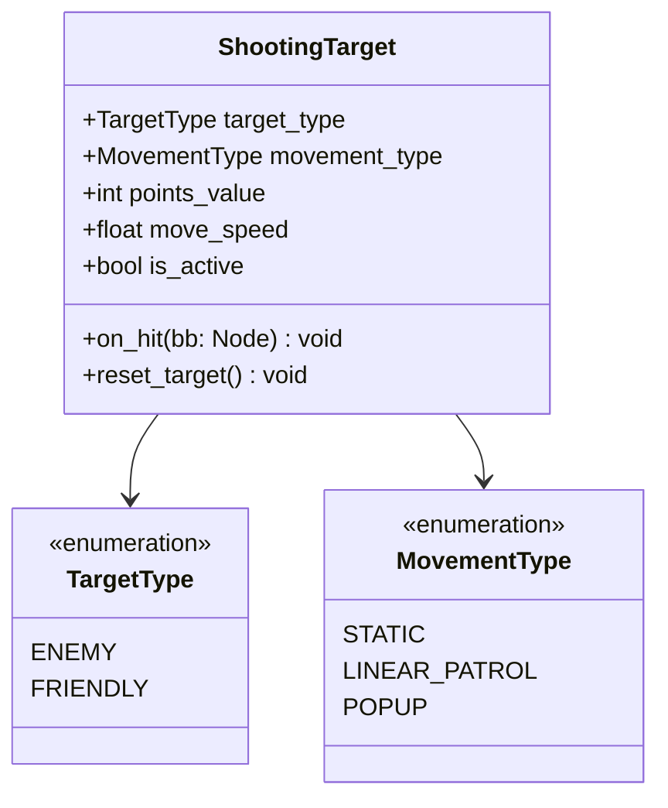

# Documento de Requisitos Adicionais - Airsoft Simulator

Este documento estabelece a especificação técnica dos novos sistemas adicionais para o simulador de Airsoft em **Godot Engine 4 (GDScript)**, complementando as regras normativas do [REQUISITOS.md](file:///c:/Users/guilh/Documents/code/game/airsoft/REQUISITOS.md).

---

## 1. Shooting Gallery (Estande de Tiro) e Classes de Alvos

O sistema de Shooting Gallery implementa uma área de treinamento reativa com alvos móveis e estáticos classificados por facção, suportando detecção balística de BBs e premiação/penalização de pontos.

### 1.1 Classificação e Tipos de Alvos (`TargetNode` / `ShootingTarget`)

Cada alvo é uma entidade independente (`Node3D` ou `Area3D`/`StaticBody3D`) que possui as seguintes propriedades normativas:

| Propriedade | Tipo | Descrição |
| :--- | :--- | :--- |
| `target_type` | `Enum (ENEMY, FRIENDLY)` | Define se é um **Inimigo** (alvo hostil que concede pontos) ou **Amigo/Refém** (alvo aliado/civil que penaliza o jogador). |
| `movement_type` | `Enum (STATIC, LINEAR_PATROL, POPUP)` | Define o padrão cinemático de movimentação do suporte do alvo. |
| `points_value` | `int` | Valor base de pontuação ao ser atingido (positivo para inimigos, negativo para aliados). |
| `move_speed` | `float` | Velocidade de translação nos alvos com movimentação ativa (m/s). |
| `respawn_time` | `float` | Tempo em segundos para o alvo retornar ao estado ativo após ser abatido. |
| `is_active` | `bool` | Define se o alvo está exposto e pronto para receber impactos. |



### 1.2 Comportamentos Cinemáticos de Movimentação

1. **Alvos Estáticos (`STATIC`)**:
   - Permanecem fixos em suas posições designadas.
   - Podem ser configurados em distâncias crescentes (ex: 10m, 20m, 30m, 50m) para calibragem balística de Hop-up.
2. **Alvos em Movimento Contínuo / Patrulha (`LINEAR_PATROL`)**:
   - Transladam em vaivém linear (ping-pong) entre dois pontos limites ou ao longo de um trilho (`Path3D` ou cálculo por `Vector3`).
   - Ao atingir o limite do curso, invertem a velocidade suavemente.
3. **Alvos com Aparição Temporária (`POPUP`)**:
   - Alternam entre ocultos (deitados / rotacionados para baixo) e visíveis (erguidos).
   - Permanecem erguidos durante uma janela de tempo configurável (ex: 2.0s a 4.0s). Se não forem atingidos nesse intervalo, voltam a se ocultar sem conceder pontos.

### 1.3 Reação ao Impacto da BB
- **Detecção**: O alvo detecta colisão com projéteis pertencentes ao grupo balístico `bb_projectile`.
- **Animação / Feedback de Impacto**:
  - Tombamento mecânico para trás ou giro de 90° ao ser atingido.
  - Alvos inimigos emitem cor verde / feedback visual positivo; alvos civis/amigos emitem cor vermelha / feedback de penalidade.
  - Desativação imediata de colisões subsequentes até a conclusão do ciclo de reset/respawn para evitar pontuação repetida pela mesma BB.

---

## 2. Sistema de Pontuação e Gerenciador da Galeria (`ShootingGalleryManager`)

O gerenciador orquestra a sessão do estande de tiro, controlando cronômetro, contagem de acertos, penalidades e envio de dados para o HUD.

### 2.1 Regras de Pontuação e Multiplicadores

| Evento | Pontuação Base | Efeito no Combo |
| :--- | :--- | :--- |
| **Acerto em Alvo Inimigo (`ENEMY`)** | `+100` pontos | Incrementa streak de acertos (+1 ao multiplicador de combo). |
| **Acerto em Alvo Amigo (`FRIENDLY`)** | `-200` pontos | Reseta o multiplicador de combo para $1\times$ e aplica penalidade imediata. |
| **Disparo no Vazio / Erro** | `0` pontos | Reduz gradualmente o tempo do combo. |

* **Cálculo da Pontuação Final**:
  $$\text{Pontos Ganhos} = \text{Pontos Base} \cdot \text{Multiplicador de Combo}$$
  - O multiplicador de combo escala de $1.0\times$ até o teto configurável (ex: $4.0\times$) a cada série consecutiva de acertos inimigos.

### 2.2 Modos de Sessão

1. **Modo Contrarrelógio (`TIME_ATTACK`)**:
   - Sessão com duração definida (ex: 60 segundos).
   - Inicia com comando de ativação (botão ou disparo no gatilho de início).
   - Ao término do tempo, bloqueia novos pontos e calcula estatísticas de precisão:
     $$\text{Precisão (\%)} = \left(\frac{\text{Total de Acertos}}{\text{Total de Tiros Disparados}}\right) \cdot 100$$
2. **Modo Prática Livre (`FREE_PRACTICE`)**:
   - Sem limite de tempo; alvos resetam continuamente conforme são atingidos.
   - Permite zerar pontuação a qualquer momento via sinal ou interface.

### 2.3 Contratos de Sinais do Gerenciador
```gdscript
signal alvo_atingido(alvo: Node, tipo_alvo: int, pontos: int, multiplicador: float)
signal pontuacao_alterada(pontuacao_atual: int, delta_pontos: int)
signal sessao_iniciada(tempo_limite: float)
signal sessao_encerrada(pontuacao_final: int, precisao: float, acertos: int, penalidades: int)
signal combo_alterado(combo_atual: int, multiplicador: float)
```

---

## 3. Sistema de Recuo de Disparo (*Recoil Spray Pattern*)

Inspirado na mecânica balística de tiro tático (estilo CS e Valorant), as armas passam a apresentar curvas dinâmicas de recuo contínuo com padrão de espalhamento (*spray pattern*).

### 3.1 Dinâmica do Padrão de Recuo (Vertical e Lateral)

Durante disparos sustentados ou sequenciais rápidos (com intervalo inferior ao tempo de recuperação de recuo):

1. **Fase 1 — Elevação Vertical Inicial (Balas 1 a 5 ou 6)**:
   - O recuo é predominantemente vertical ascendente ($+\text{Pitch}$).
   - O ponto de impacto da mira sobe progressivamente a cada disparo da sequência.
   - O jogador compensa essa fase puxando o mouse para baixo.
2. **Fase 2 — Deriva Lateral com Oscilação (A partir da 6ª bala)**:
   - A subida vertical estabiliza ou atinge o patamar máximo.
   - O recuo passa a aplicar fortes forças laterais ($+\text{Yaw}$ / $-\text{Yaw}$), puxando inicialmente para um lado (ex: direita) e subsequentemente alternando para o lado oposto (esquerda).
   - O jogador compensa contrariando ativamente a direção do desvio lateral.

```
       Trajetória do Ponto de Impacto (Spray Pattern):

           (7)---(8)---(9)  <-- Balas 7-10: Puxada lateral (Yaw)
          /
        (6)                 <-- Transição de elevação máxima
        |
        (5)
        |
        (4)                 <-- Balas 1-5: Elevação linear vertical (Pitch)
        |
        (3)
        |
        (2)
        |
       (1)  [Ponto Inicial de Mira]
```

### 3.2 Tabela de Parâmetros de Recuo por Modelo de Arma

| Modelo | Balas Verticais | Intensidade Vertical (Pitch) | Intensidade Lateral (Yaw) | Taxa de Recuperação (s) |
| :--- | :--- | :--- | :--- | :--- |
| **Rifle** | 5 balas | Moderada ($1.2^\circ$ por bala) | Alta ($0.9^\circ$ alternando Esq/Dir) | $0.25\text{ s}$ |
| **PistolGlock (Auto)** | 4 balas | Alta ($1.6^\circ$ por bala) | Muito Alta ($1.3^\circ$ errática) | $0.20\text{ s}$ |
| **PistolGlock (Semi)** | N/A (unitário) | Moderada ($0.8^\circ$ com retorno ágil) | Baixa ($0.15^\circ$) | $0.15\text{ s}$ |
| **Pistol1911** | N/A (unitário) | Forte ($2.2^\circ$ por disparo) | Mínima ($0.1^\circ$) | $0.22\text{ s}$ |
| **Shotgun** | 1 ciclo (3 BBs) | Muito Forte ($3.5^\circ$ instantâneo) | Média cônica aleatória | $0.40\text{ s}$ |

### 3.3 Recuperação e Reset (*Recoil Recovery*)
- Quando o jogador cessa o fogo, um decaimento suave interpola a compensação de recuo de volta a zero na velocidade definida por `recovery_speed`.
- Se o jogador disparar antes da recuperação completa, o contador de recuo continua do índice acumulado atual, preservando o padrão de spray em rajadas curtas mal cronometradas.

---

## 4. Sistema de Movimentação Avançada (*Bunny Hop* / Strafe Jumping)

O sistema de locomoção do jogador deve suportar a técnica clássica de encadeamento de saltos (*Bunny Hop*), recompensando a coordenação motora e precisão temporal de pulos com ganho e preservação de velocidade horizontal.

### 4.1 Princípios Físicos da Mecânica
1. **Preservação de Inércia no Solo (*Jump Timing Window*)**:
   - Ao aterrissar (`is_on_floor()`), se o jogador acionar o comando de salto dentro de uma janela de tolerância de poucos quadros (ex: $\le 0.1\text{s}$ ou buffer de salto), o atrito normal com o piso **não é aplicado**.
   - A velocidade horizontal acumulada é integralmente preservada para o próximo salto.
2. **Aceleração Aérea por Strafe (*Air Strafe Acceleration*)**:
   - Enquanto estiver no ar (`not is_on_floor()`), quando o jogador move a câmera lateralmente no plano horizontal (Yaw) enquanto pressiona exclusivamente a tecla de strafe correspondente (`move_left` com virada para a esquerda, ou `move_right` com virada para a direita):
     - Um vetor de aceleração perpendicular à velocidade atual é injetado:
       $$\vec{a}_{\text{strafe}} = \text{air\_accel} \cdot (\hat{u}_{\text{wish}} \cdot \hat{v}_{\text{horizontal}})$$
     - Isso aumenta gradualmente o módulo da velocidade escalar do jogador enquanto no ar.
3. **Limite e Balanceamento de Velocidade (*Speed Clamping*)**:
   - A velocidade horizontal máxima atingível por Bunny Hop deve possuir um teto máximo configurável (ex: $15.0\text{ m/s}$ contra os $5.0\text{ m/s}$ do caminhar padrão) para evitar descontrole ou quebra da física de colisão.
4. **Penalidade de Perda de Ritmo**:
   - Caso o jogador permaneça no chão por mais de $0.1\text{s}$ sem saltar, o atrito regular do piso desacelera instantaneamente a velocidade para a velocidade padrão de corrida (`speed` / `sprint_speed`).

---

## 5. Isolamento de Colisão de Projéteis (Filtro Player e Armas)

Para assegurar consistência física e evitar que projéteis colidam acidentalmente com o próprio jogador ou com as réplicas equipadas ao se mover para a frente enquanto dispara, as camadas de física (*Collision Layers e Masks*) devem ser estritamente segregadas.

### 5.1 Matriz de Camadas de Física 3D (Collision Layers)

| Camada (Layer) | Nome | Responsabilidade |
| :---: | :--- | :--- |
| **Layer 1** | `World` | Terreno, paredes, obstáculos e estruturas estáticas do cenário. |
| **Layer 2** | `Player` | Cápsula de colisão do Jogador (`CharacterBody3D`). |
| **Layer 3** | `Weapon` | Malhas e colisores das réplicas em 1ª pessoa ou suportes. |
| **Layer 4** | `BB_Projectile` | Projéteis esféricos de 6mm em voo (`RigidBody3D`). |
| **Layer 5** | `Targets` | Alvos móveis e estáticos do Shooting Gallery. |
| **Layer 6** | `Pickups` | Áreas de coleta de carregadores e armas caídas no chão. |

### 5.2 Regras Mandatórias de Colisão para Projéteis (`BB`)
1. **Configuração de Máscara (`collision_mask`)**:
   - A camada dos projéteis (`Layer 4 - BB_Projectile`) deve monitorar **exclusivamente**:
     - `Layer 1 (World)`
     - `Layer 5 (Targets)`
   - É terminantemente proibido que a máscara da BB contenha `Layer 2 (Player)` ou `Layer 3 (Weapon)`.
2. **Exclusão de Colisão em Tempo de Execução (`Collision Exceptions`)**:
   - No momento da instanciação da BB pelo controlador da arma, deve ser invocado programaticamente:
     ```gdscript
     bullet.add_collision_exception_with(player_node)
     ```
   - Essa salvaguarda garante imunidade absoluta contra colisões falsas com o jogador e sua geometria mesmo em altas velocidades ou latências de física.


---

## 6. Sensibilidade de Mira (Padrão Valorant) e Menu de Configuração no Pause

Para proporcionar memória muscular 1:1 idêntica aos jogos de tiro competitivos táticos (especialmente Valorant), a rotação da câmera deve adotar a escala exata de sensibilidade do Valorant, com menu de ajuste em tempo real e persistência nas opções de pause.

### 6.1 Conversão de Rotação (Escala Valorant)

No padrão competitivo do Valorant:
- Cada contagem ou pixel de movimento relativo do mouse ($1\text{ count}$) a sensibilidade $1.0$ corresponde a exatamente $0.07^\circ$ de rotação angular da câmera ($\text{m\_yaw} = 0.07^\circ$).
- Em radianos:
  $$\text{fator\_radiano} = 0.07^\circ \times \left(\frac{\pi}{180^\circ}\right) \approx 0.0012217304764\text{ rad/pixel}$$
- **Fórmula de Rotação da Câmera**:
  $$\Delta\theta = -\Delta x_{\text{rel}} \cdot (\text{sensibilidade\_valorant} \cdot \text{fator\_radiano})$$
  $$\Delta\phi = -\Delta y_{\text{rel}} \cdot (\text{sensibilidade\_valorant} \cdot \text{fator\_radiano})$$
  onde:
  - $\Delta x_{\text{rel}}, \Delta y_{\text{rel}}$: movimento relativo do mouse emitido por `InputEventMouseMotion.relative`.
  - $\text{sensibilidade\_valorant}$: valor digitado ou selecionado pelo usuário (ex: $0.35$, $0.4$, $0.7$).

> [!TIP]
> Com essa escala, um jogador que utiliza sensibilidade `0.35` e 800 DPI no Valorant terá exatamente o mesmo movimento angular de mira e distância de arrasto no mousepad ($\text{cm/360}$) no Airsoft Simulator.

### 6.2 Menu de Configuração no Pause (`pause_screen.tscn` / `pause_screen.gd`)

A tela de pause deve conter uma seção de configurações de jogabilidade contendo:

1. **Controle Duplo de Sensibilidade**:
   - **Slider Horizontal (`HSlider`)**:
     - Faixa de ajuste de $0.05$ a $2.00$ (com passo fino de $0.01$).
   - **Campo Numérico (`LineEdit` ou `SpinBox`)**:
     - Permite digitação direta do valor numérico exato com até 3 casas decimais (ex: `0.385`).
     - A alteração no slider atualiza o campo numérico instantaneamente e vice-versa.
2. **Aplicação Imediata em Tempo de Execução**:
   - Modificar a sensibilidade no pause atualiza imediatamente a propriedade `valorant_sensitivity` na câmera ativa (`fps_camera_look.gd`) sem necessidade de reiniciar o jogo ou fechar a cena.
3. **Persistência das Configurações (`ConfigFile`)**:
   - As preferências devem ser salvas no arquivo `user://settings.cfg` na seção `[input]` com a chave `sensitivity = <valor>`.
   - Ao inicializar o jogo, a configuração é carregada automaticamente; caso o arquivo não exista, utiliza-se o valor padrão normativo (`default_sensitivity = 0.40`).
